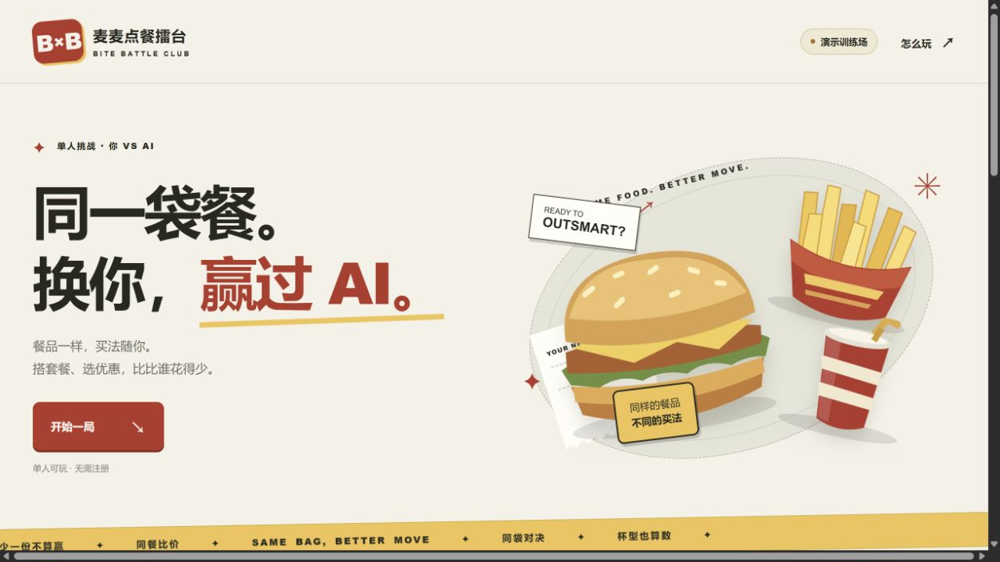
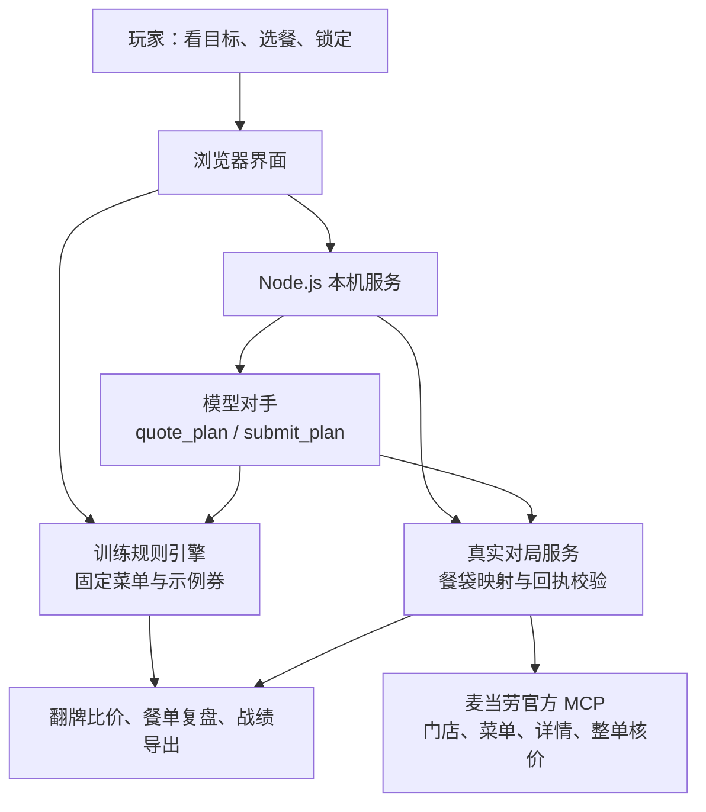

# 麦麦点餐擂台 · Bite Battle Club

**同一袋餐，你能比 AI 点得更便宜吗？**

基于麦当劳中国官方 MCP 的单人点餐策略对战应用。玩家与对手各自组合单点、套餐等买法，锁定后翻牌比价；餐品、份数、规格和默认配料一致，才有胜负。

支持内置策略对手、自带模型 API、真实门店整单核价，以及同题挑战与战绩卡导出。

麦当劳程序员创意开发大赛参赛作品 · 独立开发，非麦当劳官方产品。

[下载源码](https://github.com/Luzxxxx/mcd-bite-battle/archive/refs/heads/main.zip) · [快速试玩](#快速试玩) · [使用示例](#使用示例) · [架构](#架构) · [验证记录](docs/RELEASE_CHECK.md)



## 项目介绍

给定一袋目标餐品，例如鸡肉堡、中薯和中杯可乐，你需要在预算内决定怎么买。对手会提前选好自己的餐单，等你锁定后一起揭晓，比较两份等价餐单的实付金额。

训练场无需密钥，一个人即可开局；接入麦当劳 MCP Token 后，可以用所选门店的菜单和官方报价对战。还可以填入自己的模型 API，让模型在相同菜单和规则下出招。

| 想做什么 | 对应玩法 |
| --- | --- |
| 先玩一局，看看规则 | 训练场提供 8 道预设题、20 种餐品和 37 种买法 |
| 试试自己的搭配思路 | 自由出题，选择目标餐品并设置预算 |
| 和自己的模型较量 | 填写模型 API，模型通过工具试算并提交餐单 |
| 比较真实门店的买法 | 查询门店菜单、拆解套餐，以官方整单核价判定 |
| 让朋友挑战同一道题 | 分享训练题目与成绩，或导出 PNG 战绩卡 |

## 解决的问题

单点和套餐可能包含相同餐品，却采用不同的计价方式。比较总价之前，还要确认份数、杯型和默认配料是否一致，否则容易把少买、换规格当作省钱。

本项目把这件事做成一局可以亲手操作的策略挑战：玩家选择买法，系统展开餐袋、核对条件，再展示双方的餐单和报价。真实模式通过官方 MCP 取得菜单与价格，模型负责选择方案，金额由计价工具返回。

## 架构



| 模块 | 职责 |
| --- | --- |
| `web/` | 选餐交互、训练计价、餐袋差异、同题链接与 PNG 导出 |
| `lib/model-opponent.mjs` | 模型工具调用；校验试算结果与最终提交 |
| `lib/live-arena.mjs`、`lib/mcp-client.mjs` | 官方菜单适配、套餐拆解、商品映射与整单核价 |
| `lib/commitment.mjs`、`lib/visitor-arena.mjs` | 方案摘要、短期加密票据与揭晓校验 |

本机服务只监听 `127.0.0.1`。另提供可选 Worker 训练入口，配置与部署方式见 [架构与部署](docs/ARCHITECTURE.md)。

## 快速试玩

需要 [Node.js](https://nodejs.org/) **22.9 或更新版本**。训练场无需密钥，本机运行无需安装依赖。

**Windows：** [下载仓库 ZIP](https://github.com/Luzxxxx/mcd-bite-battle/archive/refs/heads/main.zip)，完整解压后双击 `启动试玩.cmd`，服务就绪后会自动打开浏览器。

**终端：** 在包含 `server.mjs` 的项目目录运行：

```sh
node --env-file-if-exists=.env server.mjs
```

打开 <http://127.0.0.1:4318/>。保留启动窗口，停止时按 Ctrl+C。若端口已占用，在本机 `.env` 设置 `PORT=4319`，再按日志中的地址访问。

## 使用示例

### 1. 完成第一局

目标餐袋：**鸡肉堡 × 1、中薯 × 1、中杯可乐 × 1**。

加入「鸡肉堡薯条双拼」和「可乐（中）」，点击「锁定餐单」，再点「翻牌」。

| 餐单 | 实付 |
| --- | --- |
| 玩家：鸡肉堡薯条双拼 + 可乐（中） | ¥25.90 |
| 内置策略对手：经典鸡肉堡三件套 | ¥29.90 |
| 本局差额 | ¥4.00 |

以上为训练场的虚构教学价格。换成小薯会因规格不同而无法锁定；双方实付相同则打平。

### 2. 邀请自己的 AI

在对手卡点击「用自己的 AI」，选择服务，填写 Base URL、模型 ID 和 API Key，再点击「开始对战」。模型备战完成后，你再选餐、锁定和翻牌。

页面预设 DeepSeek、通义千问 / 百炼、硅基流动，也支持部署者允许的兼容域名；模型需支持工具调用。**真实账户已实测 DeepSeek**，其他服务目前通过配置与协议测试，尚未逐家联调。

密钥只用于本页配置与当前后端请求，刷新或清除配置后移除，不进入分享链接、对局票据或战绩卡。请求经过运行项目的后端，并消耗你自己的模型额度，请在可信部署中填写。

本机也可在 `.env` 配置 `DEEPSEEK_API_KEY` 和 `DEEPSEEK_MODEL`，使用弹窗中的本机快捷入口。详见 [模型接入说明](docs/MODEL_INTEGRATION.md)。

### 3. 用真实门店菜单对战

1. 按[官方 MCP 指南](https://github.com/M-China/mcd-mcp-server)取得自己的 Token。
2. 复制 `.env.example` 为 `.env`，填写 `MCD_MCP_TOKEN`；已有文件时直接编辑。
3. 重启服务，点击右上角「演示训练场」→「检查本机接入」。
4. 搜索城市与地点，选择营业门店，从菜单中选单品或套餐开题。

实际调用链：

```text
query-nearby-stores → query-meals → query-meal-detail → calculate-price
       选门店             取菜单          拆解餐袋             整单核价
```

菜单决定可买什么，套餐详情决定实际餐品，官方整单报价决定胜负。菜单随门店与时段变化；只有能精确拆解、映射并取得完整报价的餐品才可开局。工具字段、请求样例与失败处理见 [MCP 接入说明](MCP_INTEGRATION.md)。

### 4. 分享同题与战绩

训练局结束后点击「邀请朋友」，朋友可以独立完成同一道题，接收端会重新计算成绩；点击「保存战绩」可导出 PNG。

分享使用当前页面地址。本机回环地址无法供远端朋友直接访问；跨设备时，双方需各自启动项目并保留链接中的 `#challenge=...`，或自行部署可访问的训练网页。

## 数据与能力边界

| 项目 | 当前实现 |
| --- | --- |
| 训练餐品、价格与优惠券 | 为玩法设计的固定教学数据，与真实门店价格分开 |
| 真实门店菜单与报价 | 来自官方 MCP；采用即时到店自取、默认配料，不使用账户券 |
| 模型选择 | 通过受限工具试算；模型口述金额不参与判定 |
| 胜负含义 | 在本局条件下，比当前对手便宜；不代表全菜单最低价 |
| 查询范围 | 查询菜单、拆解套餐与核价，不建单、不支付、不领取优惠券 |
| 公开试玩 | 当前提供本机启动方式；Worker 已完成本机构建与请求检查，未提供已验收的公开在线站点 |

## 技术亮点

- **按餐品核对等价关系。** 展开套餐后，比较餐品编码、份数、规格及默认特制，少一份或换杯型都会被拦住。
- **核对官方计价回执。** 除接口成功状态外，还检查返回商品的顶层编码与数量；回执缺项时停止判胜，金额按整数分比较。
- **先确定对手，再让玩家选餐。** 真实门店和模型训练对局在开局时封存方案，翻牌时由前端重算 SHA-256 摘要。浏览器内置策略训练不使用服务器封存。
- **限制模型的工具与用量。** 仅开放 `quote_plan` 和 `submit_plan`，每局最多试算三次，最终提交必须对应一次成功报价；模型失败会明确提示。
- **保持本机启动简单。** Node.js 标准库提供服务，无数据库、账户注册或运行时依赖；可选托管构建另需开发依赖。

## 实测发现

**计价接口成功，不代表请求中的餐品全部计入。** 联调时，将中杯可乐的子项编码 `3050` 直接作为顶层商品，服务可能返回成功，却在商品清单中漏掉饮料。实现改为映射官方菜单父商品与中杯选项，并校验计价回执，避免得到缺项的低价。

**模型对手会打平。** 2026-10-16 的 DeepSeek 训练对局中，双方均为 ¥25.90，方案摘要校验通过。对战结果取决于实际提交，未预设玩家获胜。详见 [验收记录](docs/RELEASE_CHECK.md) 与 [MCP 验证证据](docs/VERIFICATION.md)。

## 开发与验证

不调用外部服务的检查：

```sh
node --test
node scripts/check.mjs
node scripts/check-release.mjs
node scripts/smoke.mjs
```

以下为 **2026-10-16** 的历史验收记录，环境为 Windows、Node.js 24.19.0：

| 检查项 | 结果与证据 |
| --- | --- |
| 自动化测试 | 45 项通过，0 失败、0 跳过 |
| 页面交互 | 桌面与手机选餐、餐袋差异、自由题、同题成绩及 PNG 导出通过 |
| DeepSeek 对战 | 训练价双方 ¥25.90；官方 MCP 单品题双方 ¥14.00，原方案校验通过 |
| 官方 MCP | 门店 `1450713` 返回 121 个菜单条目；麦乐鸡题完成整单核价与回执校验 |
| 独立参赛包 | 无密钥启动、文件引用、必需材料、官方声明原文与已配置凭据检查通过 |

完整记录与截图见 [RELEASE_CHECK.md](docs/RELEASE_CHECK.md)。训练金额为虚构数据；真实金额只记录当时门店和时间，不是当前价格承诺。

需要复现真实服务时，先配置自己的凭据并启动服务，再运行：

```sh
node --env-file-if-exists=.env scripts/verify-v03.mjs
```

该脚本会消耗模型额度，有 MCP Token 时还会核价一个实时餐品。默认门店可能关闭或缺货，可先在页面另选门店。可选托管训练版的构建方法见 [架构与部署](docs/ARCHITECTURE.md)。

## 目录结构

```text
.
├── README.md                    # 项目介绍与启动方法
├── CONTEST_DECLARATION.md       # 官方参赛声明原文
├── MCP_INTEGRATION.md           # 服务、工具、调用流程与业务价值
├── mcp-config.example.json      # 仅含环境变量占位符的 MCP 示例
├── .env.example                # 本机配置模板
├── 启动试玩.cmd                 # Windows 启动入口
├── server.mjs                  # 本机 HTTP 服务
├── web/                        # 页面、训练数据、计价与同题链接
├── lib/                        # MCP 适配、模型对手、餐袋映射与票据
├── worker/                     # 可选托管训练入口
├── tests/                      # 规则、模型、MCP 与分享测试
├── scripts/                    # 检查、构建与真实联调脚本
├── skills/mcd-bite-battle/      # Agent 使用入口，需保留完整项目
└── docs/                       # 使用说明、验证记录与截图
```

## 目标用户

- 喜欢研究套餐搭配的消费者：亲手比较同一袋餐的不同买法。
- 喜欢策略与解谜的玩家：独立出题、挑战对手，再与朋友比较成绩。
- 开发者与比赛观众：复现 MCP 菜单查询、整单核价和模型工具调用流程。

## 参赛材料

已通过[报名申请 #809](https://github.com/M-China/mcd-developer-innovation-challenge/issues/809)参赛，官方账号 M-China-Official 于 2026-10-16 回复[“您的作品已成功参赛”](https://github.com/M-China/mcd-developer-innovation-challenge/issues/809#issuecomment-6216025358)。报名回执不代表最终排名或获奖审核结果。

| 材料 | 内容 |
| --- | --- |
| [README.md](README.md) | 项目介绍、安装、使用示例与目标用户 |
| [CONTEST_DECLARATION.md](CONTEST_DECLARATION.md) | 官方参赛声明，保留原文 |
| [MCP_INTEGRATION.md](MCP_INTEGRATION.md) | 实际使用的 MCP 服务、工具、流程与价值 |
| [mcp-config.example.json](mcp-config.example.json) | 脱敏配置，仅含环境变量占位符 |
| [提交说明](docs/SUBMISSION.md) | 材料清单与报名记录 |

未使用 WorkBuddy，未申报其专项奖励。活动要求以[官方比赛仓库](https://github.com/M-China/mcd-developer-innovation-challenge)为准。

## 项目说明

本项目为独立参赛作品，非麦当劳官方产品。真实餐品、价格与供应以官方当次返回为准，报价不能替代实际成交结果。

使用与演示见 [USAGE.md](docs/USAGE.md)，开发与反馈见 [CONTRIBUTING.md](CONTRIBUTING.md)，素材及文档结构参考见 [ATTRIBUTION.md](docs/ATTRIBUTION.md)。
