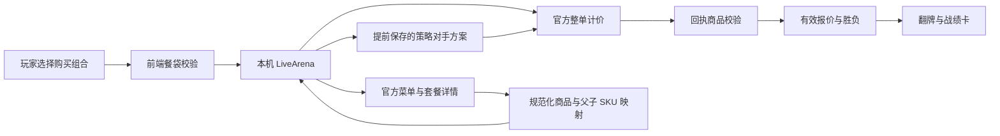

# 麦麦点餐擂台：从可玩原型到参赛作品

> 本文保留 v0.1 阶段的规划与基线。v0.2 已实现手机餐袋栏、同题分享、DeepSeek 工具出招和营业门店选择；当前能力与本轮验收以 [V02_RELEASE.md](V02_RELEASE.md) 为准。

## 项目一句话

**同一袋餐，你能比 AI 点得更便宜吗？**

用户独自组餐、锁定、翻牌，发现同样的食物因购买组合不同而产生价差。玩完带走一份看得懂、能复用的买法；战绩卡让朋友接着挑战。主入口直接开始一局，扫码与双人同时在线都不是前提。

它的吸引力来自亲自决策和揭晓结果。实用价值来自比较相同内容的真实餐单，帮助用户理解套餐、单点和优惠条件。第一轮先证明这种体验成立，再增加题目复杂度。

## 当前已经落地

| 部分 | 当前实现 | 尚待完成 |
| --- | --- | --- |
| 单人交互 | 点击/拖入、改份数、选搭配、核对餐袋、提示、锁定翻牌、重试 | 更紧凑的新手引导与操作反馈 |
| 训练 | 三类策略、示例券、自由出题、明确胜/平/负 | 题目难度筛选与真实案例题库 |
| 真实 MCP | 当前门店菜单、套餐详情、父子 SKU、官方整单计价、回执检查 | 门店选择、时段适配、更多套餐和真实券 |
| AI 对手 | 披露策略的确定性算法，真实对手先提交方案 | 大模型工具调用对手与复盘讲解 |
| 传播 | 本地 PNG 战绩卡，保留来源与非官方说明 | 同题分享链接、固定版本重玩与真正的挑战邀请 |
| 交付 | 无 npm 依赖的源码、Windows 启动入口、比赛文档、项目 Skill | GitHub 公开仓库、正式报名、演示视频 |

这是第一版可玩且能接入官方数据的 MVP，还不是面向大量用户的商业服务。线上试玩部署为私有静态训练版；真实模式在本机使用个人 Token。当前没有把个人 Token 搬到公共服务。

## 一局怎么玩：目标 30–60 秒

1. **看题，5 秒。** 屏幕直接给出这一餐必须收到什么、预算和对手风格。先用一局普通汉堡 + 中薯 + 中杯饮料理解规则。
2. **出招，20–35 秒。** 选择套餐或拆分组合，份数和杯型实时核对。价格之外，明确提示“多一份”“少一杯”“规格不同”。
3. **锁定与翻牌，5 秒。** 对手方案提前保存，玩家不能看完答案再修改本次方案。真实模式重新核价，失败时不判胜。
4. **看懂差异，10 秒。** 同屏展示两份购买结构、同袋证明和差价；玩家可以修改重试或生成战绩卡。

第一版不设强制注册，不先问十个偏好问题，不把模型聊天框放在主屏。页面已经具备完整闭环。

## 一致餐袋是产品核心

内部将购买计划展开为规范化的多重集合：

```text
key = 餐品子项编码 + 全部已支持的规格/特制签名
value = 实际收到的份数
```

同餐验证与报价验证分开。用户少点中薯、换小杯或换无糖都不能直接算便宜。账户券、门店、渠道和时段也必须属于同一局条件。真实第一版只支持默认特制，无法准确映射时就不出该题。

本次接口调研发现：杯型子项可能不是可直接下单的顶层 SKU，接口甚至可能成功返回却静默漏项。因此还要核对价格回执里的每个顶层商品与份数。这个校验已经实现并有回归测试；详细边界见 `MCP_INTEGRATION.md`。

## 技术方案与数据流



前端是原生 HTML/CSS/ESM，无构建步骤，方便比赛复现。规则引擎负责整数分金额、集合匹配、示例券和有限候选搜索。本机 Node 服务保存个人 Token、对手原方案和官方请求映射，浏览器只得到题目与公开候选。原始调试响应放在忽略目录，公开材料只保留脱敏证据。

多人访问真实模式需要单独的服务端部署、会话隔离、每用户授权/凭据方案、额度管理、滥用控制与数据存储设计。不能直接把本机服务绑定公网当成上线完成；更不能默认让所有访客共用当前个人 Token。

## 下一阶段优先做什么

### P0：把“能玩”验证成“想再来一局”

找 5–8 个没听过项目的人，先观察不解释。记录能否在 15 秒内理解题意、是否成功组出同袋、首局完成用时、揭晓是否有惊喜、是否愿意重玩/分享。先修最常见的操作障碍，再加功能。

首轮试验目标是首局完成率至少 70%、中位完成时间不超过 60 秒、至少 3 人主动重试。这里是待验证的目标，当前没有用户实验结果。

### P0：扩展真实题目与门店时段

从同一门店现有菜单中，找出可确认“套餐 / 随心配 / 单点”精确等价的题目。只保留能完整报价、价差或决策有意义的题目。加入门店选择和营业状态提示，不能让所有访客默认挑战已经闭店的测试门店。

2026-10-16 00:00，官方对当前测试门店返回 `600057`、提示可能闭店或不在营业时间。这已经说明时段适配是实测需求。没有真实价格时仍可玩标注清楚的训练题。

### P1：大模型参与出招，但裁判仍由规则和官方报价担任

给大模型结构化菜单、目标餐袋、候选购买方案与明确的工具预算，让它提出有限个候选、调用报价工具、在玩家出招前提交最终方案。输出经过 schema 和餐袋校验，不允许模型编造券或金额。

可选“套餐派”“精算派”等不同策略；能力与搜索预算公开。强对手得到最优解时允许平局，玩家目标可以是以更少尝试匹配最佳价。不要靠故意犯错、看到玩家方案再改答案、夸大能力来制造赢的效果。

大模型最有价值的第二个位置是复盘：用一句话解释“你把套餐拆成随心配再补中薯，餐袋相同，整单少了多少”。当前没有选择模型供应商，也没有产生大模型调用费用。

### P1：让战绩卡变成可继续玩的邀请

分享卡下一步附带同题链接，包含挑战版本、题目 ID、策略档位和训练/真实来源。朋友可独自尝试，不需要双方在线。真实历史挑战必须显示价格时间；重玩时按当前报价开新局，不把截图价格当作锁价。

公开榜需要保存合法对局与反作弊证据，应在最小单人体验被验证后再实现。初期优先“我的这一招能省多少，你来试试”，不先做复杂积分体系。

### P2：真实优惠券与个人餐单

先确认券的资格、门槛、可用商品、互斥关系和官方计价参数，再支持用户账户券。玩家与对手使用同一份可用券快照，券失效时重新验证。查询和模拟使用不应擅自领券或绑定账户。自由输入想吃什么，则需先生成用户能确认的规范餐袋，再出题。

## 到比赛截止的建议节奏

以官方当前列明的 **2026-10-25 23:59 北京时间**为截止，建议压缩范围：

| 时间 | 可验收结果 |
| --- | --- |
| 10/16–10/17 | 5–8 人试玩，修手机操作；门店营业/供应提示；确认项目名称 |
| 10/18–10/20 | 做好一位真正调用工具的大模型对手；增加至少 3 道可核验且有趣的真实题 |
| 10/21–10/22 | 同题分享链接、清楚的复盘、录制 60–90 秒演示 |
| 10/23 前 | 清理凭据与提交材料，公开 GitHub 仓库，按格式报名并核验成功回复 |
| 10/24–10/25 | 收集真实反馈、修阻塞问题，传播试玩与项目，避免临近截止才首次报名 |

上表为工作建议，不是已完成事项。[官方比赛仓库](https://github.com/M-China/mcd-developer-innovation-challenge)当前说明排名依赖公开 Star 数据，因此除了作品完整度，还要让别人能迅速试玩、看懂价值。不要购买 Star 或把技术展示当成已获得名次。

## 60–90 秒演示脚本

- 0–8 秒：标题“同一袋餐，你比 AI 会点吗？”直接展示目标餐袋。
- 8–25 秒：让观众点一个直觉方案，页面指出杯型不符，立即更正。
- 25–45 秒：尝试套餐拆分/随心配，锁定，双方翻牌。
- 45–65 秒：展示真实门店、官方报价、两份购买结构和同袋校验；赢、输、平都按真实结果呈现。
- 65–90 秒：一句复盘，生成战绩卡，朋友可以独自玩同类题。

真实录制应在门店营业期间执行；若演示训练局，全程保留示例标识，不把预录结果冒充直播。

## 参赛材料与剩余决策

已准备 README、原样官方参赛声明、MCP_INTEGRATION、运行代码、项目 Skill 和验证材料。报名 Issue 草稿在 `docs/SUBMISSION_DRAFT.md`。

正式报名仍需一个公开 GitHub 仓库地址和用户对最终展示内容的确认。当前没有代用户提交声明、报名或申请 WorkBuddy 专项；没有实际 WorkBuddy 开发记录，不应编造 `workbuddy.md`。用户个人 Token 只留本机，源码包不包含它。

这一版最重要的下一步是让真人试玩并补门店时段适配。随后接入大模型与分享链接，使作品既有可解释的真实价值，也有更鲜明的 AI 互动体验。
