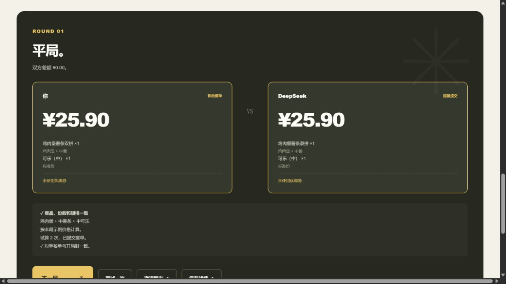

# 参赛包验收 · v0.3.2

验收日期：2026-10-16。从本文件所在的独立参赛目录启动，未使用原开发目录的代码、安装目录或站点账号。环境为 Windows、Node.js 24.19.0；可选构建使用 pnpm 11.25.0、esbuild 0.28.2。

真实联调临时读取原本机环境文件中的凭据；凭据未复制进参赛包。其他使用者需要自己的账户与配置。机器记录见 [release-check.json](release-check.json) 与 [browser-release.json](browser-release.json)。

## 检查结果

| 项目 | 结果 |
| --- | --- |
| 现有自动化测试 | 45 通过，0 失败、0 跳过；不调用外部服务 |
| JavaScript 语法与入口资源 | 通过，含 Node 服务入口 |
| 无密钥启动 | 通过；七个网页资源正常返回，无运行时依赖 |
| Windows 启动脚本 | 普通 Windows PATH 无 Node 时，能找到本机 Codex 环境；目录外启动与重复启动复用均通过 |
| 本机接口 | 跨站调用被拒绝，环境文件不可访问，缺少 MCP 时明确提示 |
| Worker | 锁文件安装、无原站点配置的构建、七个嵌入资源与请求处理通过 |
| 比赛材料 | 必需文件齐全，官方声明与原始文件逐字节一致 |
| 文件引用 | Markdown 本地链接、前端资源和源码相对导入检查通过 |
| 凭据检查 | 参赛文件中未发现本机已配置的真实 Token 与模型密钥 |
| 桌面与手机 | 训练翻牌、餐袋差异、自由题、接题成绩和 PNG 导出通过 |
| 响应式 | 320 / 390 / 760 / 900 / 1440 像素宽度无页面横向溢出 |
| 浏览器错误 | 本轮已测页面脚本错误为 0 |

训练首局实测为玩家 ¥25.90、策略对手 ¥29.90；换成小薯被拦住。接收同题链接后，双方成绩重新计算为 ¥25.90，正确显示打平。咖啡加苹果派自由题可完成并得到平局。手机餐袋加减份数、底部锁定和翻牌正常，战绩 PNG 文件头校验通过。

## 真实服务

- **自带 API 训练接口**：DeepSeek `deepseek-flash`，试算两次；双方训练价均为 ¥25.90，原方案 SHA-256 验证通过，响应不含 API Key。
- **页面真实模型流程**：通过本机模型快捷入口备战，玩家选餐、锁定、翻牌；双方 ¥25.90 平局，前端显示「对手餐单与开局时一致」。
- **官方 MCP**：门店 `1450713` 返回 121 个菜单条目；动态菜单题选择麦乐鸡 `1401`，双方官方报价均为 ¥14.00，完整计价回执验证通过。
- **自带 API + 官方 MCP**：同一麦乐鸡题邀请 DeepSeek，模型试算两次；双方官方报价均为 ¥14.00，完整回执与原方案承诺均通过。官方报价时间为 2026-10-16 14:57:28。

这些金额仅记录当时的门店、供应和模型结果。训练金额是虚构数据；真实金额不是当前价格承诺，也不是固定胜负。

## 整理时修正

1. 分享链接改用当前页面域名，去掉原私人预览地址。
2. Worker 构建不再强制依赖原站点的账号配置。
3. 发布检查可直接检查文件夹，无需先有 Git 历史；有历史时仍会扫描。
4. 更新说明中的按钮名、测试数量和动态菜单能力，去掉旧版本的三题限制描述。
5. 补充独立启动检查、Worker 检查和官方声明换行保护。
6. 修复 Windows 启动脚本换行，避免从其他目录启动时找错服务入口。
7. 补测 Windows 普通启动环境：原验收继承了 Codex 的 PATH，未覆盖资源管理器双击。现在自动寻找符合版本要求的 Node，等待服务就绪再打开浏览器，重复启动时复用服务；从 ZIP 使用前需完整解压。

原开发目录保持不动，本参赛目录版本为 0.3.2。没有上传 GitHub、修改线上访问权限或提交报名 Issue。

## 适用范围

本机三种玩法在上述条件下均已跑通。真实模型仅实测 DeepSeek；其他服务使用配置及协议测试，不保证每个模型 ID 都支持工具调用。部分复杂官方菜单仍会拒绝开题。托管版完成本机构建和请求处理检查，未将私人预览写成已通过的公开演示。

跨设备分享需要对方也启动项目，或另行部署可访问的网页；回环地址不能让远端朋友访问你的电脑。本轮未逐一测试所有操作系统和浏览器。
