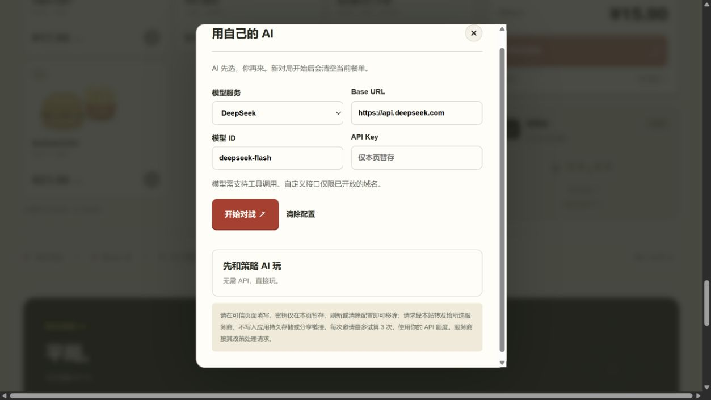
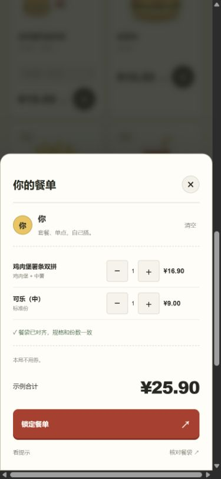

# 使用与演示

## 两分钟试玩

1. 按 [README](../README.md) 启动本机服务，打开日志中的地址。
2. 看目标餐袋：鸡肉堡、中薯、中杯可乐。
3. 加入「鸡肉堡薯条双拼」和「可乐（中）」。
4. 锁定餐单、翻牌。玩家示例价 ¥25.90，对手 ¥29.90。
5. 点「邀请朋友」得到同题链接；或「保存战绩」下载 PNG。

可以先选小薯展示错误提示：便宜的前提是收到同一袋餐，少一份或换规格都不算。

## 用自己的 AI

在对手卡点「用自己的 AI」，选择服务，填写 Base URL、模型 ID 和 API Key，再点「开始对战」。等待模型备战成功后，按自己的想法选餐、锁定、翻牌。模型失败会明确提示，不会替换成策略对手。

不要在演示投屏时展示密钥；密钥输入框默认遮挡。刷新或清除本页配置即可清除。其他服务商的模型是否支持工具调用，应以该账户实际可用能力为准。

## 手机与自由题

手机底部显示餐袋与金额，点餐袋展开抽屉，调整数量和选券后关闭即可继续。点「自己出题」，最多选择五份食物，再设置预算。训练数据与用券条件在这一局固定。

## 真实门店演示

本机配置自己的 MCP Token 后，从右上角数据入口检查接入，搜索城市和商圈，选营业门店，再查看本店菜单。菜单单品或套餐能被准确拆解并取得完整报价后，才能开局。可优先选择普通单品，或页面提供的快捷题。

若门店关闭、餐品下架、默认选配无法映射或计价回执漏项，改选其他餐品或门店。真实胜负以本次报价为准，演示不预设输赢。

## 分享的范围

分享保留题目、训练数据版本与合法的邀请者方案，不携带模型密钥或答案。训练成绩在接收端重新算价，真实局重新查询门店。

本机服务只监听回环地址，所以直接发出的 localhost 链接无法让远端朋友访问你的电脑。双方都启动项目时，可把链接中 `#challenge=...` 放到对方的本机页面地址后；部署网页后，分享将自动使用该网页域名。
